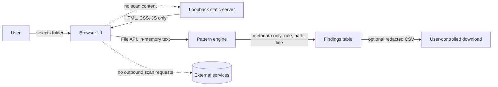

# Architecture

## Components

| Component | Technology | Responsibility |
| --- | --- | --- |
| UI | HTML, CSS, browser JavaScript | Folder selection, progress, result table, filters, review state, CSV download |
| Detection engine | `assets/scanner.js` | Fixed regular-expression rules and bounded placeholder heuristics; emits metadata only |
| Report serializer | `assets/report.js` | Properly quotes CSV cells, neutralizes formula-leading fields, and excludes matched values |
| Local static server | `serve.py` using Python standard library | Serves the page and allowlisted assets on `127.0.0.1`; sets response headers; has no scan endpoint |
| Tests | Node built-in test runner, Python `unittest` | Detector and local server checks; no test dependencies |

No database, external API, authentication provider, telemetry, AI model, or cloud storage is included.

## Component view

## Data flow

1. User explicitly chooses a folder using the browser's folder picker.
2. The browser exposes selected `File` objects to the page; files in excluded directories, files above 1 MiB, and inputs beyond the count/total limits are skipped.
3. Browser JavaScript reads one file at a time, rejects content containing NUL bytes as binary, splits text into lines, and evaluates six fixed rules.
4. The scanner discards matched text immediately and returns only detector metadata, severity, path, line, confidence label, and remediation text.
5. The UI inserts all file-derived text through `textContent`, keeps review state in memory, and can export a CSV without matched values.

## Trust boundaries

- **Local project to browser:** User-selected, potentially untrusted file contents and paths.
- **Local browser to loopback server:** Static GET/HEAD requests for allowlisted application files only. Scan content is not sent to this server.
- **Browser to external services:** No automatic traffic. The CISA guidance link opens only when the user activates it.
- **Browser to local download:** Optional CSV report metadata selected by the user.

## Deployment and configuration

Run `python serve.py` and visit the printed loopback URL. The app has no environment variables and does not require a database or install step. The server rejects non-loopback Host names and non-read-only HTTP methods, serves only `/`, `/index.html`, and five named files under `/assets/`, and sets CSP, no-sniff, frame-denial, no-referrer, permissions-policy, and no-store headers.

## Design limits

Browser directory selection is not uniformly supported across browsers. Current UI behavior is intended for current Chromium browsers. There is no Git history scan, provider verification, archive extraction, credential rotation integration, persistence, or organization-wide monitoring.
